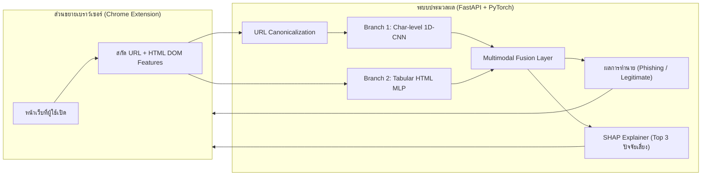

# โครงร่างโครงงานปริญญาตรี (Senior Project Proposal)

**ชื่อโครงงาน (ภาษาไทย):** การพัฒนาระบบตรวจจับเว็บไซต์ฟิชชิงแบบอธิบายได้ด้วยการผสานคุณลักษณะพหุฐานนิยมของ URL และโครงสร้าง HTML พร้อมการประเมินผลข้ามชุดข้อมูล  
**ชื่อโครงงาน (ภาษาอังกฤษ):** Explainable Multimodal Phishing Webpage Detection Using URL and HTML Structural Fusion with Cross-Dataset Evaluation

---

## 1. ที่มาและความสำคัญของปัญหา (Background and Rationale)
การโจมตีแบบฟิชชิง (Phishing) ยังคงเป็นภัยคุกคามทางไซเบอร์อันดับต้นๆ ที่สร้างความเสียหายต่อผู้ใช้งานและองค์กรทั่วโลก แนวทางการตรวจจับแบบดั้งเดิมที่พึ่งพาบัญชีรายชื่อเว็บไซต์อันตราย (Blacklists) ไม่สามารถรับมือกับเว็บไซต์ฟิชชิงที่สร้างขึ้นใหม่แบบ Zero-day ซึ่งมีอายุการใช้งานสั้นเพียงไม่กี่ชั่วโมงได้ ส่งผลให้มีการนำ Machine Learning (ML) และ Deep Learning (DL) มาประยุกต์ใช้ในการตรวจจับอัตโนมัติ

อย่างไรก็ตาม จากการทบทวนวรรณกรรมในช่วง 5 ปีที่ผ่านมา (ค.ศ. 2021–2026) พบช่องว่างทางความรู้ (Knowledge Gaps) ที่สำคัญ 3 ประการในงานวิจัยระดับปัจจุบัน:
1. **ข้อจำกัดของการพึ่งพา URL เพียงอย่างเดียว (Single-Modality Limitation) และปัญหา Shortcut Learning:** โมเดลที่วิเคราะห์เฉพาะสายอักขระของ URL มักถูกหลอกเมื่อผู้โจมตีนำหน้าเว็บปลอมไปฝากไว้บนบริการ Cloud หรือ Free Web Hosting ที่น่าเชื่อถือ (ทำให้ URL ดูปลอดภัย) ยิ่งไปกว่านั้น งานวิจัยล่าสุดพบว่าชุดข้อมูลมาตรฐานหลายชุดมีอคติเชิงโครงสร้าง (Sampling Bias) เช่น URL ปกติมักขึ้นต้นด้วย `https://www.` เสมอ ทำให้โมเดลจำทางลัด (Shortcut Learning) ได้ความแม่นยำในชุดข้อมูลสูงถึง 99.9% แต่เมื่อนำไปทดสอบกับข้อมูลภายนอก ค่า AUROC กลับลดลงเหลือเพียง 0.54
2. **การขาดการทดสอบข้ามชุดข้อมูล (Cross-Dataset Generalization Gap):** งานวิจัยส่วนใหญ่วัดผลเฉพาะการแบ่งข้อมูล Train/Test ภายในชุดข้อมูลเดียวกัน (In-distribution) แต่ขาดการทดสอบความทนทานเมื่อรูปแบบการกระจายตัวของข้อมูลเปลี่ยนไป (Distribution Shift)
3. **การขาดความโปร่งใสและความเข้ากันได้กับการใช้งานจริง (Explainability & Real-Time Client Constraints):** โมเดล Deep Learning มักทำงานแบบ Black-box ที่ผู้ใช้ไม่ทราบเหตุผลในการแจ้งเตือน และฟีเจอร์บางชนิดในงานวิจัย (เช่น อายุโดเมนจาก WHOIS หรืออันดับเว็บจาก Third-party API) ใช้เวลาดึงข้อมูลนานเกินกว่าจะนำมาใช้สแกนแบบ Real-time บนเว็บเบราว์เซอร์ได้

โครงงานนี้จึงนำเสนอการพัฒนาโมเดล **Multimodal Deep Learning** ที่ผสานการเรียนรู้ลำดับอักขระของ URL (ผ่าน Character-level 1D-CNN) เข้ากับคุณลักษณะโครงสร้าง HTML/DOM ที่สามารถสกัดได้ทันทีจากหน้าเว็บเบราว์เซอร์ พร้อมทำการปรับมาตรฐาน URL (URL Canonicalization) เพื่อลด Shortcut Learning ประเมินความทนทานข้ามชุดข้อมูล และใช้เทคนิค **Explainable AI (SHAP)** อธิบายเหตุผลประกอบการแจ้งเตือนผ่านต้นแบบ **Chrome Extension**

---

## 2. วัตถุประสงค์ของโครงงาน (Objectives)
1. เพื่อออกแบบและพัฒนาโมเดล Multimodal Deep Learning ที่ผสานข้อมูลสายอักขระ URL และคุณลักษณะโครงสร้าง HTML/DOM สำหรับตรวจจับเว็บไซต์ฟิชชิง
2. เพื่อเปรียบเทียบประสิทธิภาพและความทนทานของโมเดลแบบ Multimodal เทียบกับโมเดลแบบ Single-Modality (URL อย่างเดียว หรือ HTML อย่างเดียว) และ Classical ML (LightGBM/XGBoost) ทั้งในชุดข้อมูลเดียวกันและ**ข้ามชุดข้อมูล (Cross-Dataset Evaluation)**
3. เพื่อประยุกต์ใช้เทคนิค Explainable AI (SHAP) ในการระบุคุณลักษณะสำคัญที่มีผลต่อการตัดสินใจของโมเดล
4. เพื่อพัฒนาส่วนขยายเว็บเบราว์เซอร์ (Chrome Extension) เชื่อมต่อกับระบบ API หลังบ้าน สำหรับตรวจจับและแสดงเหตุผลแจ้งเตือนเว็บไซต์ฟิชชิงแบบ Real-time

---

## 3. ขอบเขตของโครงงาน (Scope of Work)
1. **ด้านชุดข้อมูล (Datasets):** ใช้ชุดข้อมูลสาธารณะมาตรฐานยุคใหม่ ได้แก่ **PhiUSIIL Phishing URL (Website) Dataset (2024)** จำนวน 235,795 ตัวอย่าง และชุดข้อมูล **LegitPhish (2025) / PhiLegit-100K (2026)** สำหรับการประเมินผลข้ามชุดข้อมูล
2. **ด้านคุณลักษณะ (Features):** คัดเลือกเฉพาะคุณลักษณะของ URL และโครงสร้าง HTML/DOM ที่สามารถสกัดได้โดยตรงจากฝั่ง Client (Client-side extractable features) โดยไม่พึ่งพาการเรียกใช้บริการภายนอกที่มีความหน่วงสูง (เช่น DNS/WHOIS lookup)
3. **ด้านการวัดผล (Evaluation Metrics):** ประเมินผลด้วย Accuracy, Precision, Recall, Macro F1-Score, PR-AUC, **False Positive Rate (FPR)** และเวลาที่ใช้ในการประมวลผลต่อหนึ่งหน้าเว็บ (Inference Latency)
4. **ด้านระบบต้นแบบ (Prototype):** พัฒนาเป็น Chrome Extension (Manifest V3) ที่ดึงข้อมูล URL และ DOM จากแท็บที่เปิดอยู่ ส่งไปยัง FastAPI Backend และแสดงผลลัพธ์พร้อมปัจจัยเสี่ยงสูงสุด 3 อันดับแรก

---

## 4. ระเบียบวิธีวิจัยและสถาปัตยกรรมระบบ (Methodology)

---

## 5. แผนการดำเนินงาน 16 สัปดาห์ (Project Timeline)

| สัปดาห์ที่ | กิจกรรมและรายละเอียดการดำเนินงาน | ผลลัพธ์ที่ได้ (Deliverables) |
| :---: | :--- | :--- |
| **1–2** | ศึกษาวรรณกรรมที่เกี่ยวข้อง ดาวน์โหลดชุดข้อมูล `PhiUSIIL` และ `LegitPhish` และทำ Exploratory Data Analysis (EDA) | รายงานสรุปลักษณะข้อมูลและรายการ Features ที่คัดเลือก |
| **3–4** | ทำ URL Canonicalization, Data Preprocessing และพัฒนาโมเดล Baseline (LightGBM, Random Forest) | โค้ดเตรียมข้อมูลและตารางผลลัพธ์ Baseline |
| **5–7** | พัฒนาโมเดล Deep Learning แยกแต่ละส่วน (`Char-CNN` สำหรับ URL และ `MLP` สำหรับ HTML) และรวมเป็น `Multimodal Fusion` | โมเดล Multimodal ที่ผ่านการเทรนและปรับจูนเบื้องต้น |
| **8–9** | ดำเนินการทดลองที่ 1 (Ablation Study) และการทดลองที่ 2 (Cross-Dataset Evaluation) | ตารางเปรียบเทียบประสิทธิภาพและกราฟ ROC / PR Curve |
| **10–11** | บูรณาการโมดูล Explainable AI (SHAP) และวัดผล Inference Latency | กราฟวิเคราะห์ SHAP Summary & Force Plots |
| **12–13** | พัฒนา FastAPI Backend และสร้างส่วนขยาย Chrome Extension (Manifest V3) | ระบบต้นแบบที่เชื่อมต่อ API สำเร็จ |
| **14–16** | ทดสอบระบบต้นแบบกับหน้าเว็บจำลอง สรุปผลการวิจัย เขียนเล่มรายงานฉบับสมบูรณ์ และเตรียมสไลด์นำเสนอ | เล่มโครงงานฉบับสมบูรณ์และซอฟต์แวร์ต้นแบบ |

---

## 6. รายการไฟล์ Paper ในโฟลเดอร์ `papers/` (ดาวน์โหลดไว้แล้ว 8 เรื่อง)

| ลำดับ | ไฟล์ในโฟลเดอร์ `papers/` | ชื่อเปเปอร์ (ปีที่ตีพิมพ์) |
| :---: | :--- | :--- |
| **1** | [`papers/01_PhiUSIIL_Feature_Selection_Phishing_2025_arXiv_2503.01799.pdf`](./papers/01_PhiUSIIL_Feature_Selection_Phishing_2025_arXiv_2503.01799.pdf) | *Optimizing Phishing URL Detection with Correlation Based Feature Selection* (2025) |
| **2** | [`papers/02_Lightweight_Hybrid_MLP_PhiUSIIL_2026_arXiv_2606.00889.pdf`](./papers/02_Lightweight_Hybrid_MLP_PhiUSIIL_2026_arXiv_2606.00889.pdf) | *A Lightweight Hybrid MLP-Based Framework for Real-Time Phishing URL Detection* (2026) |
| **3** | [`papers/03_Unified_Semantic_Structural_Char_URL_2025_arXiv_2509.10287.pdf`](./papers/03_Unified_Semantic_Structural_Char_URL_2025_arXiv_2509.10287.pdf) | *Unified Semantic-Structural-Character Learning for Malicious URL Detection* (2025) |
| **4** | [`papers/04_URLNet_2018_arXiv_1802.03162.pdf`](./papers/04_URLNet_2018_arXiv_1802.03162.pdf) | *URLNet: Learning a URL Representation with Deep Learning for Malicious URL Detection* (2018) |
| **5** | [`papers/05_Robust_Explainable_Transformer_Phishing_2026_arXiv_2511.12085.pdf`](./papers/05_Robust_Explainable_Transformer_Phishing_2026_arXiv_2511.12085.pdf) | *A Robust and Explainable Transformer-Based Framework for Phishing Detection* (2026) |
| **6** | [`papers/06_Memory_Augmented_MultiModal_Phishing_2026_arXiv_2602.21394.pdf`](./papers/06_Memory_Augmented_MultiModal_Phishing_2026_arXiv_2602.21394.pdf) | *Memory-Augmented Multi-Modal LLM Agent for Phishing URL Detection* (2026) |
| **7** | [`papers/07_Explainable_AI_Phishing_URL_SHAP_2026.pdf`](./papers/07_Explainable_AI_Phishing_URL_SHAP_2026.pdf) | *Explainable AI for Phishing URL Detection: A Bayesian-Optimized Stacking Ensemble Framework with SHAP* (2026) |
| **8** | [`papers/08_Survey_Malicious_URL_Detection_2025_arXiv_2504.16449.pdf`](./papers/08_Survey_Malicious_URL_Detection_2025_arXiv_2504.16449.pdf) | *A Survey of Malicious URL Detection Techniques, Datasets, and Challenges* (2025) |

---

## 7. เปเปอร์เพิ่มเติมสำหรับดาวน์โหลดผ่านเบราว์เซอร์ (5 เรื่อง)

| ลำดับ | ชื่อเปเปอร์ (ปีที่ตีพิมพ์) | หมายเหตุ | ลิงก์สำหรับกดดาวน์โหลด |
| :---: | :--- | :--- | :--- |
| **1** | **Prasad & Chandra (2024)** — *PhiUSIIL: A diverse security profile empowered phishing URL detection framework...* | ใช้ Wi-Fi / VPN มหาวิทยาลัยเพื่อโหลดจาก ScienceDirect | https://doi.org/10.1016/j.cose.2023.103545 |
| **2** | **Potpelwar et al. (2025)** — *LegitPhish: A large-scale annotated dataset for URL-based phishing detection* | Open Access (PubMed Central) | https://pmc.ncbi.nlm.nih.gov/articles/PMC12538017/ |
| **3** | *A Multimodal Phishing Website Detection System Using Explainable Artificial Intelligence* (MDPI, 2026) | Open Access (MDPI) | https://www.mdpi.com/2504-4990/8/1/11 |
| **4** | *Detecting Phishing URLs Based on a Deep Learning Approach to Prevent Cyber-Attacks* (MDPI, 2024) | Open Access (MDPI) | https://www.mdpi.com/2076-3417/14/22/10086 |
| **5** | *Mitigating False-Positive Cascades in URL-Based Phishing Detection* (JFES, 2025/2026) | Open Access (ชี้จุดบอด Shortcut Learning ใน `PhiUSIIL`) | https://doi.org/10.59746/qh2b6881 |

---

## 8. ลิงก์ดาวน์โหลดชุดข้อมูล (Public Datasets)
* **PhiUSIIL Phishing URL (Website) Dataset (UCI Repository):** https://archive.ics.uci.edu/dataset/967/phiusiil+phishing+url+dataset
* **LegitPhish Dataset (Mendeley Data):** https://data.mendeley.com/datasets/hx4m73v2sf/1
* **PhiLegit-100K Dataset (Mendeley Data):** https://data.mendeley.com/datasets/726pyz4j53
